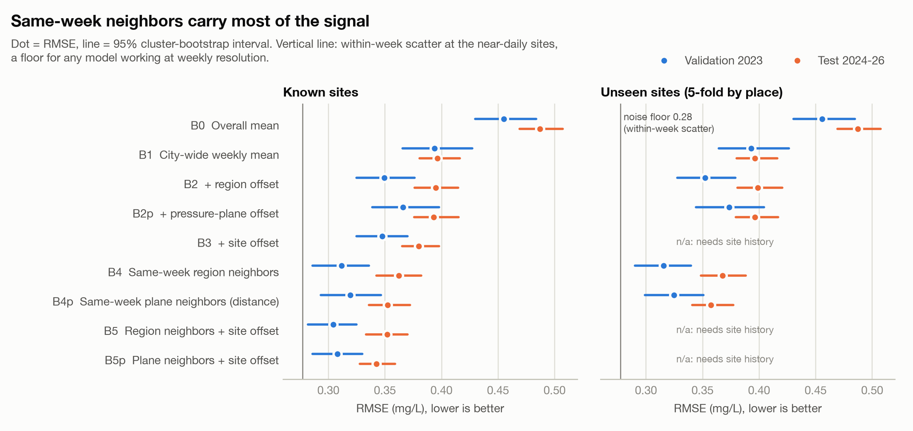
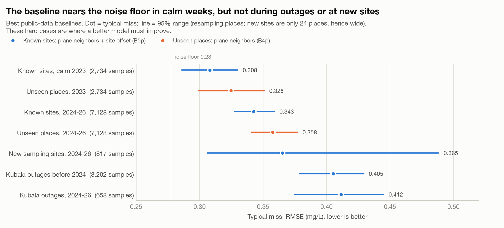
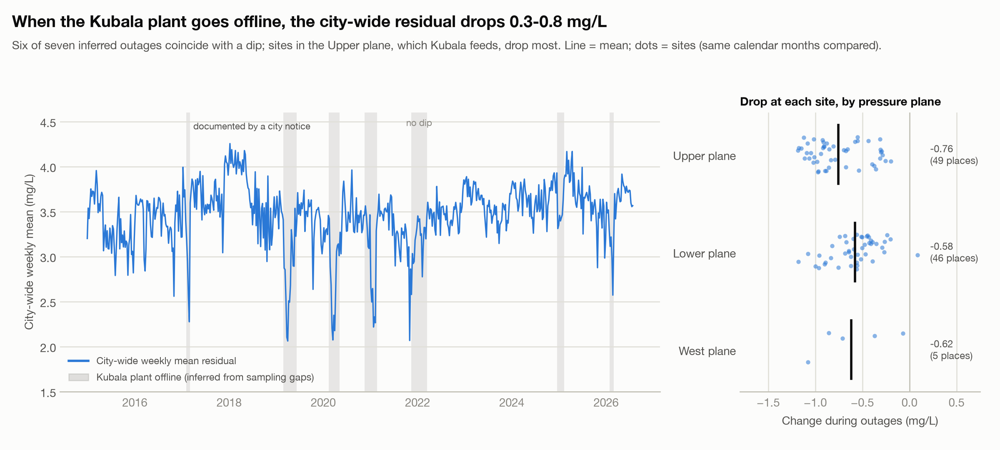

# Virtual Chlorine Sensors for Arlington's Water System

Estimating chlorine residual (the disinfectant left in tap water) across Arlington, Texas, from the water
utility's routine lab samples and publicly available city GIS data.

## Summary

Arlington's water lab samples about 47 places in a typical week; a typical place has a sample in only 43% of
its active weeks, and most of the city's 100,000+ addresses are never sampled. This project builds a
**virtual sensor**: an estimate of total chlorine (mg/L) at any place and week, with a confidence range,
built from what nearby sampling sites measured that week plus public location information (the pressure zone
of the nearest fire hydrants, distance to each treatment plant). It works without the city's pipe network,
which is not public.

## Status

| Phase | Work | Status |
|---|---|---|
| 1 | Data cleaning, public GIS features, plant-outage inference, exploration, evaluation framework, baseline models | **Complete** (this repository) |
| 2 | Main model: regression kriging (being explored); plant-outage modeling; error analysis | Next |
| 3 | Calibrated uncertainty, final evaluation, report and presentation | Planned |

## Results at a glance

Typical miss (RMSE, mg/L; lower is better). Typical chlorine levels are about 3.5 mg/L.

| Situation | Best baseline | RMSE |
|---|---|---|
| Known sites, 2023 (validation) | B5: nearby sites this week + the site's usual offset | **0.304** (vs. 0.455 for always guessing the average: 33% smaller) |
| Places never sampled, 2023 | B4: nearby sites in the same utility region this week | **0.316** |
| Known sites, 2024 – July 2026 (final check, used once) | B5p: same-pressure-zone neighbors (public map) + site offset | **0.343** |
| Places never sampled, 2024 – July 2026 | B4p: same-pressure-zone neighbors, closer sites count more | **0.358** |
| Kubala treatment-plant outages, before 2024 | B5p | 0.405 |

Key findings:

- **This week's nearby readings carry most of the signal**: using them cuts the typical error by a third.
- **It works at places never sampled**, almost as well as at monitored sites.
- **Public data is enough**: the public pressure-zone map works as well as the utility's internal region codes.
- **More monitored places mean smaller errors** at unsampled places (0.364 with 36 places, 0.316 with 143).
- **Plant outages are the hard case**: when the Kubala plant is offline, chlorine drops 0.3 – 0.8 mg/L
  city-wide (6 of 7 inferred outages).
- **Noise floor**: two samples at the same spot in the same week differ by about 0.28 mg/L, which no weekly
  method can beat; the best baselines are close to it in calm weeks.







## How to run

Requires Python 3.11+ and [uv](https://docs.astral.sh/uv/).

```bash
uv sync
```

Download the public City of Arlington GIS layers (fire hydrants, address points, road centerlines):

```bash
bash scripts/fetch_public_gis.sh
```

Place the lab export at the repository root as `Chlorine_residual_2015-2027.xlsx` (see Data access), then:

```bash
uv run python -m chlorine.cleaning.pipeline
```

```bash
uv run python -m chlorine.evaluation.run --learning-curve
```

```bash
uv run python -m chlorine.evaluation.figures
```

```bash
uv run python -m chlorine.reporting.figures
```

```bash
uv run python -m chlorine.reporting.numbers
```

```bash
uv run pytest
```

1. **Cleaning** writes the modeling table and a data-quality report to `data/processed/v1/`.
2. **Evaluation** scores every baseline on the 2023 validation year (`data/eval/val/`). The 2024 – 2026 test
   period is evaluated with `--split test --confirm-test`; it was run once, after all settings were fixed, and
   every run is logged.
3. **Figures** and the **key-numbers sheet** are written to `reports/`. Tests that need the private data skip
   automatically when it is absent.

## Data access

- **Lab data (not included).** The analysis uses an export of the Arlington Water Utilities laboratory
  records system (58,492 rows, January 2015 – August 2026). It is not in this repository because it contains
  customer names and phone numbers, and the processed tables contain sampling-site addresses. Access is through
  the utility.
- **Public GIS (downloaded by the script).** From the City of Arlington's public GIS server
  (`gis2.arlingtontx.gov`): 12,321 fire hydrants with their pressure zone, 102,855 address points and 17,322 road
  segments. The city does not publish its water mains.
- **Privacy.** Customer free text is never written to any output (the pipeline refuses to save outputs that
  contain a phone-number pattern), analysts are pseudonymized, geocoding runs locally, and everything in
  `reports/` is aggregated.

## Repository map

```
config/              reference tables: facilities, site overrides, external events, geocode overrides
scripts/             public GIS download
src/chlorine/
  cleaning/          lab export -> modeling table: scope, location resolution, duplicates, privacy, geocoding,
                     public features, plant-outage inference, data-quality report
  evaluation/        evaluation framework: time splits, held-out places, leakage-safe neighbor features,
                     baseline models (B0 - B5p), metrics with bootstrap intervals, figures 1 - 3
  reporting/         presentation figures 6 - 16 and the key-numbers sheet
  config.py          every setting in one place
tests/               unit tests and checks on the built outputs
reports/
  figures/           figures (aggregates only), each with a CSV of the numbers behind it
```

## Verification

Every number used in the presentation was recomputed from the lowest-level source available (the raw export,
saved predictions, event tables), with code written separately from the pipeline that first produced it, and
compared with the value quoted; all **109 checks match**. Outside facts (Texas and EPA rules, plant
capacities, previous studies) were checked against their published sources.

