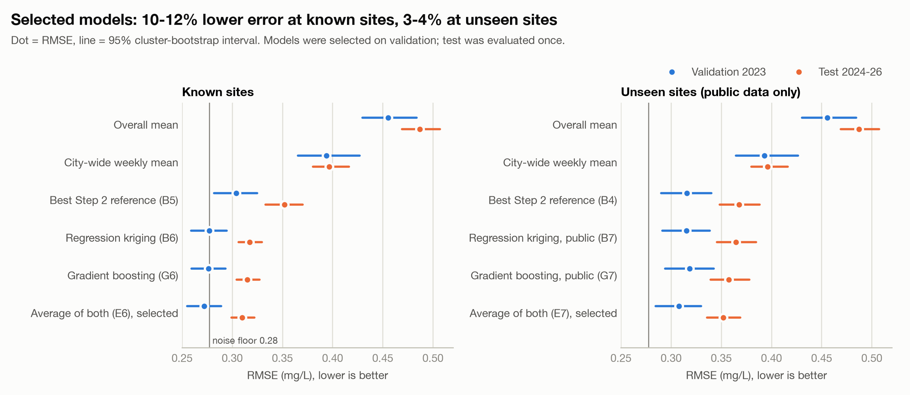
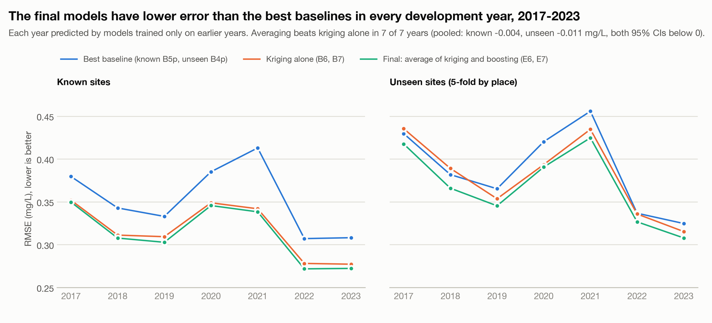
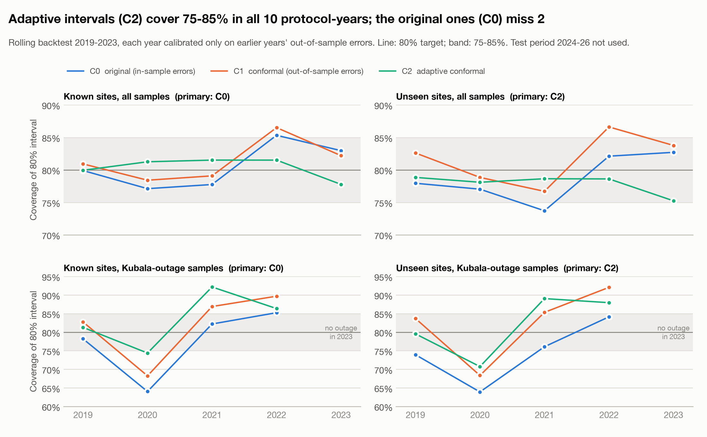
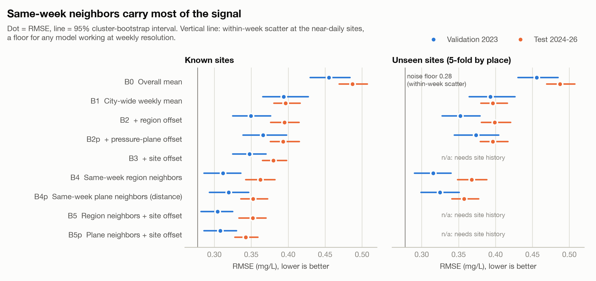
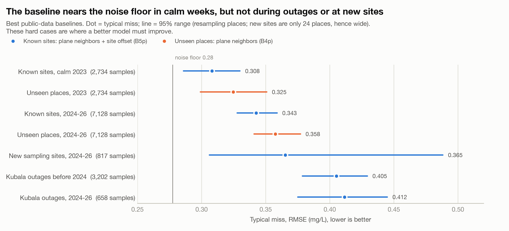
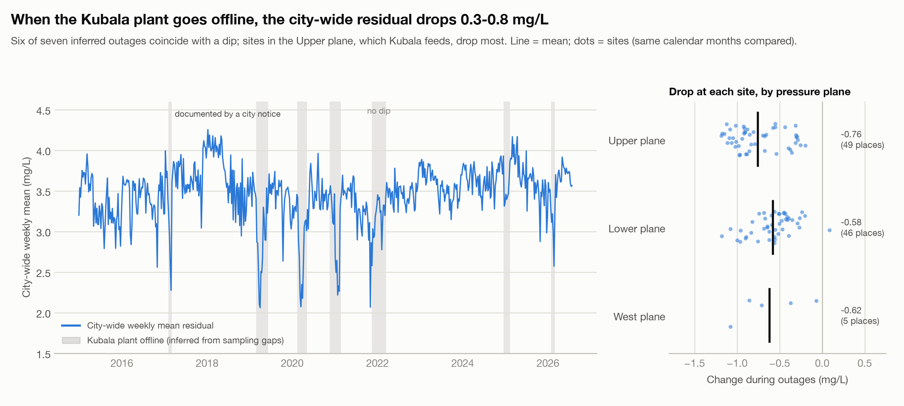

# Virtual Chlorine Sensors for Arlington's Water System

Estimating chlorine residual (the disinfectant left in tap water) across Arlington, Texas, from the water
utility's routine lab samples and publicly available city GIS data.

## Summary

Arlington's water lab samples about 47 places in a typical week; a typical place has a sample in only 43% of
its active weeks, and most of the city's 100,000+ addresses are never sampled. This project builds a
**virtual sensor**: an estimate of total chlorine (mg/L) at any place and week, with a confidence range,
built from what nearby sampling sites measured that week plus public location information (the pressure zone
of the nearest fire hydrants, distance to each treatment plant). It works without the city's pipe network,
which is not public.

## How it works

1. **Clean the lab export.** 58,492 lab rows become 30,701 numeric total-chlorine samples at 208 places. Conflicting site
   codes and addresses are reconciled, duplicates removed, and customer free text kept out of all outputs.
2. **Add public location data.** Sites are geocoded locally, then given a pressure zone (from the 7 nearest fire
   hydrants), distance to each treatment plant, and nearby hydrant age and density.
3. **Infer plant outages.** No operations log is available, so a gap of at least 28 days in a plant's finished-water
   samples is treated as that plant being offline.
4. **Fix the test rules first.** Train on 2015 – 2022, choose on 2023, and check on January 2024 – July 2026. Models are
   tested at monitored places, at places hidden entirely from them, and during hidden plant outages. Automated tests
   confirm that a sample's own value cannot reach its prediction.
5. **Build baselines.** A ladder of 14 simple rules shows what each idea is worth and sets the bar for later models.
6. **Build the main models.** Regression kriging combines a regression on public features with spatial interpolation
   of what the regression misses, learning how similarity falls with distance and across pressure zones. Gradient
   boosting is averaged in for robustness.
7. **Check the uncertainty and freeze.** Prediction intervals are studied on development data. The final models are
   frozen, with 4 hypotheses pre-registered for one evaluation on new data.

This is a nowcast: it fills in places and weeks using other sites' readings from the same week. It does not forecast
future weeks, and it does not assess regulatory compliance.

## Status

| Phase | Work | Status |
|---|---|---|
| 1 | Data cleaning, public GIS features, plant-outage inference, exploration, evaluation framework, baseline models | **Complete** |
| 2 | Main models: regression kriging averaged with gradient boosting; plant-outage modeling; error analysis | **Complete** |
| 3 | Prediction-interval calibration, rolling backtest, pre-registered prospective test | **Frozen and registered**; the prospective test runs once 12 months of new samples exist |

## Results at a glance

Typical miss (RMSE, mg/L; lower is better). Typical chlorine levels are about 3.5 mg/L.

| Situation | Best baseline | RMSE |
|---|---|---|
| Known sites, 2023 (validation) | B5: nearby sites this week + the site's usual offset | **0.304** (vs. 0.455 for always guessing the average: 33% smaller) |
| Places never sampled, 2023 | B4: nearby sites in the same utility region this week | **0.316** |
| Known sites, 2024 – July 2026 (final check) | B5p: same-pressure-zone neighbors (public map) + site offset | **0.343** |
| Places never sampled, 2024 – July 2026 | B4p: same-pressure-zone neighbors, closer sites count more | **0.358** |
| Kubala treatment-plant outages, before 2024 | B5p | 0.405 |

Key findings:

- **This week's nearby readings carry most of the signal**: using them cuts the typical error by a third.
- **It works at places never sampled**, almost as well as at monitored sites.
- **Public data is enough**: the public pressure-zone map works as well as the utility's internal region codes.
- **More monitored places mean smaller errors** at unsampled places (0.364 with 36 places, 0.316 with 143).
- **Plant outages are the hard case**: when the Kubala plant is offline, chlorine drops 0.3 – 0.8 mg/L
  city-wide (6 of 7 inferred outages).
- **Noise floor**: two samples at the same spot in the same week differ by about 0.28 mg/L, which no weekly
  method can beat; the best baselines are close to it in calm weeks.

## Main models

E6 (monitored places) and E7 (any place) average regression kriging with gradient boosting. Details:
[model card](docs/model_card.md), [modeling notes](docs/modeling.md),
[prospective registration](docs/prospective_registration.md).

| Situation, 2024 – July 2026 | Main model RMSE | Best baseline RMSE |
|---|---|---|
| Monitored places | **0.310** (E6) | 0.343 (B5p) |
| Places hidden from the model | **0.352** (E7) | 0.358 (B4p) |
| Kubala outages, monitored places | **0.363** (E6) | 0.412 (B5p) |

In a 2017 – 2023 rolling backtest, E6 and E7 each beat the best baseline in all 7 years. Their original 80% prediction
intervals covered only 73 – 76% of test samples, so we compared recalibration methods on development data; adaptive
conformal prediction stayed within 75 – 85% coverage in all 5 years studied.

Explore every place and model on the [results map](reports/map/chlorine_results_map.html) (download the file and open
it in a browser).













## How to run

Requires Python 3.11+ and [uv](https://docs.astral.sh/uv/).

```bash
uv sync
```

Download the public City of Arlington GIS layers (fire hydrants, address points, road centerlines):

```bash
bash scripts/fetch_public_gis.sh
```

Place the lab export at the repository root as `Chlorine_residual_2015-2027.xlsx` (see Data access), then:

```bash
uv run python -m chlorine.cleaning.pipeline
```

```bash
uv run python -m chlorine.evaluation.run --learning-curve
```

```bash
uv run python -m chlorine.evaluation.figures
```

```bash
uv run python -m chlorine.modeling.run
```

```bash
uv run python -m chlorine.modeling.backtest
```

```bash
uv run python -m chlorine.modeling.backtest --members
```

```bash
uv run python -m chlorine.modeling.backtest --horizon 2019:2022
```

```bash
uv run python -m chlorine.modeling.sensitivity
```

```bash
uv run python -m chlorine.modeling.calibration
```

```bash
uv run python -m chlorine.reporting.figures
```

```bash
uv run python -m chlorine.reporting.numbers
```

```bash
uv run python -m chlorine.reporting.sampling_map
```

```bash
uv run pytest
```

1. **Cleaning** writes the modeling table and a data-quality report to `data/processed/v1/`.
2. **Evaluation and modeling** score every model on the 2023 validation year. The 2024 – 2026 test period is run with
   `--split test --confirm-test`. It was scored once for the baselines and once for the main models, after their
   settings were fixed, then used once as training and calibration data for the frozen models, with no metrics
   computed. Every use is logged.
3. **Figures**, the **key-numbers sheet** and the **results map** are written to `reports/`. Tests that need the
   lab data skip automatically when it is absent.

The prospective test is `uv run python -m chlorine.modeling.prospective evaluate --raw NEW.xlsx --confirm`. It runs once,
on the first export with at least 12 months of samples after the 2 August 2026 cutoff.

## Data access

- **Published with the lab's permission.** `published_data/chlorine_samples.csv` is the modeling table (30,703 rows,
  30,701 with a numeric value; analyst codes removed). `published_data/sampling_sites.csv` lists the 221 sampling
  locations with coordinates and public features (addresses removed). `docs/data_dictionary.md` defines the columns.
- **Raw lab export (not included).** The Arlington Water Utilities laboratory export (58,492 rows, January 2015 –
  August 2026) contains customer names and phone numbers. The full cleaning output is also withheld because it can
  contain addresses from customer complaint samples. The published tables are for analysis; rerunning the pipeline from
  the start needs the export, available through the utility.
- **Public GIS (downloaded by the script).** From the City of Arlington's public GIS server
  (`gis2.arlingtontx.gov`): 12,321 fire hydrants with their pressure zone, 102,855 address points and 17,322 road
  segments. The city does not publish its water mains.
- **Privacy.** Customer free text is never written to any output (the pipeline refuses to save outputs that
  contain a phone-number pattern), analysts are pseudonymized, geocoding runs locally, and published files
  contain no addresses.

## Repository map

```
config/              reference tables: facilities, site overrides, external events, geocode overrides
scripts/             public GIS download
src/chlorine/
  cleaning/          lab export -> modeling table: scope, location resolution, duplicates, privacy, geocoding,
                     public features, plant-outage inference, data-quality report
  modeling/          regression kriging, gradient boosting, averages, backtest, interval calibration, prospective test
  evaluation/        evaluation framework: time splits, held-out places, leakage-safe neighbor features,
                     baseline models (B0 - B5p), metrics with bootstrap intervals, figures 1 - 3
  reporting/         figures 6 - 16, the key-numbers sheet and the results map
  config.py          every setting in one place
docs/                model card, modeling, evaluation and cleaning notes, data dictionary, prospective registration
tests/               unit tests and checks on the built outputs
reports/
  figures/           figures (aggregates only), each with a CSV of the numbers behind it
  map/               interactive results map for every sampling place and model
published_data/      modeling table and sampling-site table
```

## Verification

Every number used in the presentation was recomputed from the lowest-level source available (the raw export,
saved predictions, event tables), with code written separately from the pipeline that first produced it, and
compared with the value quoted; all **109 checks match**. Outside facts (Texas and EPA rules, plant
capacities, previous studies) were checked against their published sources.

